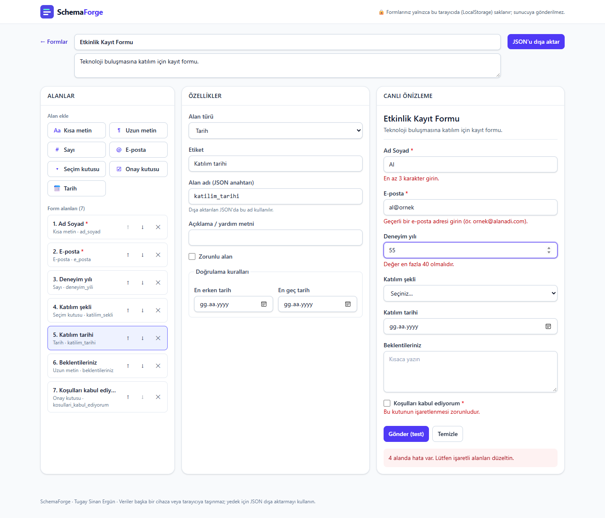
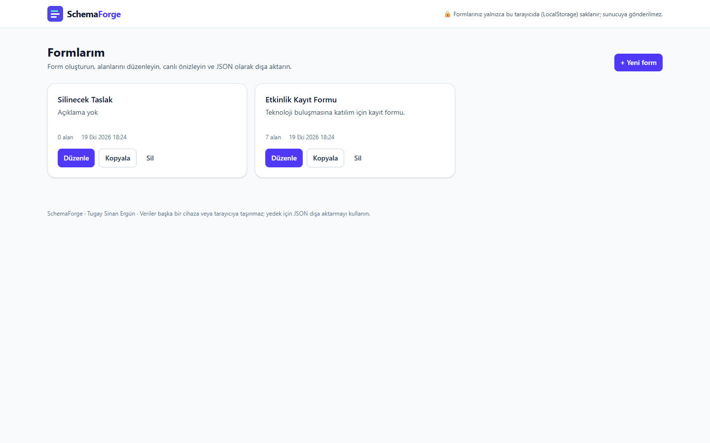
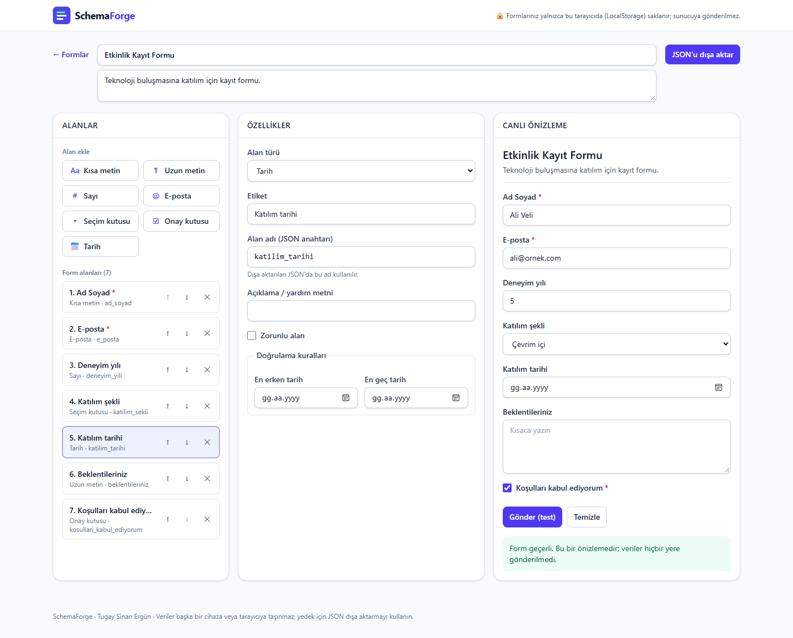
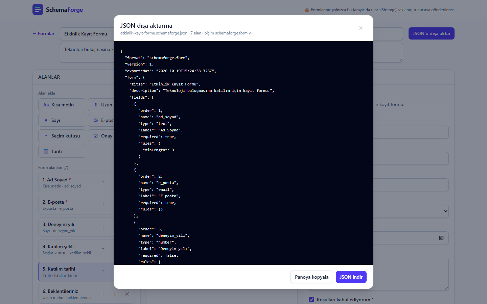
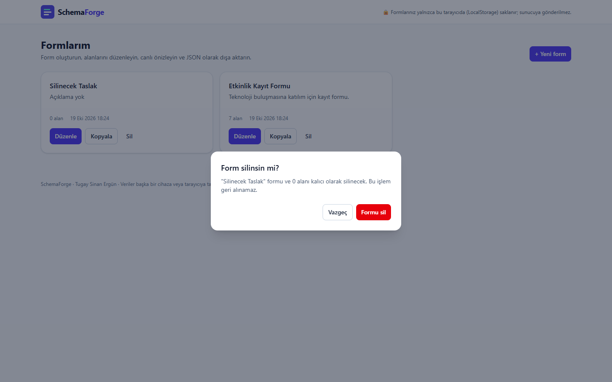
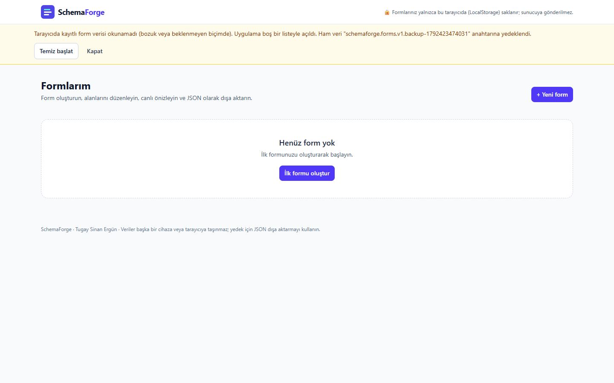
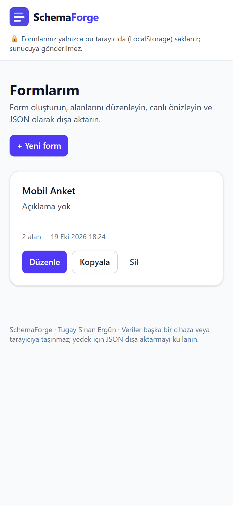

# SchemaForge — Dinamik Form Tasarım Platformu

**Eğitim:** Web Geliştirme; Yapay Zeka · **Author / Maintainer:** Tugay Sinan Ergün · **GitHub:** TCoderr

SchemaForge, tarayıcıda çalışan bir form tasarım uygulamasıdır. Kullanıcı şunları yapabilir:
- formları oluşturmak, listelemek, düzenlemek, kopyalamak ve silmek;
- 7 alan türünden alan eklemek ve düzenlemek;
- doğrulama kuralları belirlemek;
- formu canlı önizlemede gerçek doğrulamayla denemek;
- form şemasını JSON olarak dışa aktarmak.

Veriler tarayıcının **LocalStorage** alanında saklanır.

> **Gizlilik:** Formlar yalnızca kullandığınız tarayıcıda saklanır; sunucuya gönderilmez, başka cihaza taşınmaz. Tarayıcı verileri temizlenirse formlar silinir. Yedek için JSON dışa aktarmayı kullanın.



## Özellikler

- **Form yönetimi (CRUD):** oluştur, listele, başlık ve açıklamayı düzenle, kopyala, **onaylı** sil.
- **Alan türleri:** kısa metin, uzun metin, sayı, e-posta, seçim kutusu, onay kutusu, tarih.
- **Alan özellikleri:**
  - etiket;
  - JSON alan adı (etiketten otomatik üretilir, Türkçe karakterler dönüştürülür, benzersiz olması denetlenir);
  - yer tutucu ve yardım metni;
  - zorunluluk;
  - sıra (yukarı/aşağı).
- **Doğrulama kuralları:**
  - zorunlu alan;
  - en az / en fazla karakter;
  - e-posta biçimi;
  - sayı aralığı;
  - tarih aralığı;
  - seçim listesi;
  - zorunlu onay kutusu.

  Çelişkili kurallar uyarı olarak gösterilir.
- **Canlı önizleme:** Gerçek HTML alanları kullanılır. Doğrulama alandan çıkınca ve gönderince çalışır. Hatalar ekran okuyuculara `aria-invalid` ve `aria-describedby` ile bağlıdır. Veri hiçbir yere gönderilmez.
- **Kalıcılık:** LocalStorage; sayfa yenilenince veriler korunur. Bozuk veya kısmen geçersiz veride uygulama çökmez:
  - Okunamayan veri ayrı bir anahtara yedeklenir ve kullanıcıya bildirilir.
  - Geçerli formlar kurtarılır.
- **JSON dışa aktarma:** Biçim `schemaforge.form` v1; alan sırası, tür, etiket, ad, zorunluluk, kurallar ve seçenekler. Dosya olarak indirilebilir veya panoya kopyalanabilir.
- **Erişilebilirlik:**
  - semantik HTML;
  - label–input ilişkileri;
  - klavyeyle kullanım;
  - görünür odak;
  - erişilebilir onay penceresi;
  - "İçeriğe atla" bağlantısı.
- **Duyarlı tasarım:** Masaüstünde üç panel, mobilde alt alta yerleşim.

Hangi özelliğin test edildiği ve neyin olmadığı: **[ACTUAL_FEATURES.md](ACTUAL_FEATURES.md)**.

## Teknolojiler

React 19 · TypeScript 6 · Vite 8 · Tailwind CSS 4 · LocalStorage · Vitest 5 + React Testing Library · Playwright (yerel Microsoft Edge) · ESLint 10

## Kurulum ve çalıştırma

Gereksinim: Node.js 20+ (geliştirmede v24.18.0 kullanıldı).

```bash
npm install
npm run dev          # http://localhost:5173
npm run build        # tsc -b && vite build  -> dist/
npm run preview      # derlenmiş sürüm: http://localhost:4173
npm run lint
npm test             # Vitest: birim + entegrasyon testleri
npm run test:e2e     # Playwright: kurulu Microsoft Edge ile tarayıcı testleri + ekran görüntüleri
node scripts/collect-results.mjs   # hepsini çalıştırır, docs/TEST_REPORT.md üretir
```

## Test sonuçları

Ayrıntılar: [docs/TEST_REPORT.md](docs/TEST_REPORT.md). Ham çıktılar: `docs/test-results/`.

**1.1 (19.10.2026) — Kapsamlı fonksiyonel denetim:** 62 etkileşim envanteri, 35 yeni tarayıcı testi, 10 hata bulundu (1 CRITICAL, 3 HIGH düzeltildi; 2 MEDIUM, 4 LOW **1.0.2'de düzeltildi**; önce belgelendi). Raporlar: `reports/UI_INTERACTION_AUDIT.md`, `reports/FUNCTIONAL_TEST_REPORT.md`, `reports/BUG_FIX_REPORT.md`, `reports/LIVE_SITE_VERIFICATION.md`.

| Kontrol | Sonuç |
|---|---|
| TypeScript (`tsc -b`) | Hatasız |
| ESLint | Hatasız |
| Vitest + React Testing Library | 43/43 |
| `npm run build` | Başarılı |
| Playwright (Edge, masaüstü + mobil) | 39/39 (bilinen kusur testi yok) |
| Playwright, **canlı Netlify sitesine karşı** | [reports/LIVE_SITE_VERIFICATION.md](reports/LIVE_SITE_VERIFICATION.md) §4 (1.0.1, `952fa87`: 33 başarılı + 6 bilinen kusur) |

Görevdeki 12 kullanıcı senaryosunun tamamı otomatik testle doğrulandı:
1. form oluşturma
2. listeleme
3. başlık düzenleme
4. alan ekleme
5. tür değiştirme
6. zorunlu alan doğrulaması
7. alan silme
8. form silme
9. yenileme sonrası kalıcılık
10. JSON dışa aktarma
11. geçersiz veri
12. mobil görünüm

## Ekran görüntüleri (gerçek tarayıcı, Playwright + Edge)

| | |
|---|---|
|  |  |
|  |  |
|  |  |

## Proje yapısı

```
src/
├── interfaces/form.ts        # veri modeli: alan türleri, kurallar, form şeması
├── lib/                      # fields (oluşturma/tür değiştirme), validation, storage (güvenli okuma), exportSchema
├── hooks/                    # useForms (durum + kalıcılık), useHashRoute (yönlendirme)
├── components/               # FieldsPanel, PropertiesPanel, PreviewPanel, ExportDialog, ConfirmDialog, StorageBanner, ErrorBoundary
├── pages/                    # DashboardPage, EditorPage
├── App.tsx, main.tsx
└── *.test.ts(x)              # Vitest testleri
e2e/                          # Playwright testleri (schemaforge.spec.ts, functional.spec.ts)
docs/                         # TEST_REPORT, DEPLOYMENT, ekran görüntüleri, ham test çıktıları
reports/                      # fonksiyonel denetim: envanter, test, hata ve canlı site raporları
```

## Dağıtım

Netlify ayarları `netlify.toml` dosyasında: build `npm run build`, publish `dist`. Ayrıntılı adımlar: [docs/DEPLOYMENT.md](docs/DEPLOYMENT.md).

**Bağlantılar** (19.10.2026'da doğrulandı):
- **Canlı site (Netlify Free):** https://schemaforge-tcoderr.netlify.app
- **GitHub deposu (public):** https://github.com/TCoderr/SchemaForge

Canlı sitedeki test sonuçları ve yayımlanan sürümün commit kimliği: [reports/LIVE_SITE_VERIFICATION.md](reports/LIVE_SITE_VERIFICATION.md).

Not: Site, Netlify CLI ile `dist` klasöründen elle yayımlandı. GitHub'dan otomatik yayın (sürekli dağıtım) henüz bağlanmadı; adımlar `docs/DEPLOYMENT.md` içinde.

## İlgili kampanya

FormPilot AI, SchemaForge'a bağlı eğitim amaçlı bir marka kampanyasıdır (`D:\Project\FormPilot-AI`). Uygulamada yapay zekâ, belge/PDF işleme veya otomatik form üretimi **yoktur**; ayrıntılar `ACTUAL_FEATURES.md` dosyasında.

## Lisans ve katkı

MIT lisansı (`package.json`). Kod, Claude Code (Anthropic) yardımıyla geliştirildi ve test edildi. Proje sahibi ve sorumlusu Tugay Sinan Ergün'dür.
